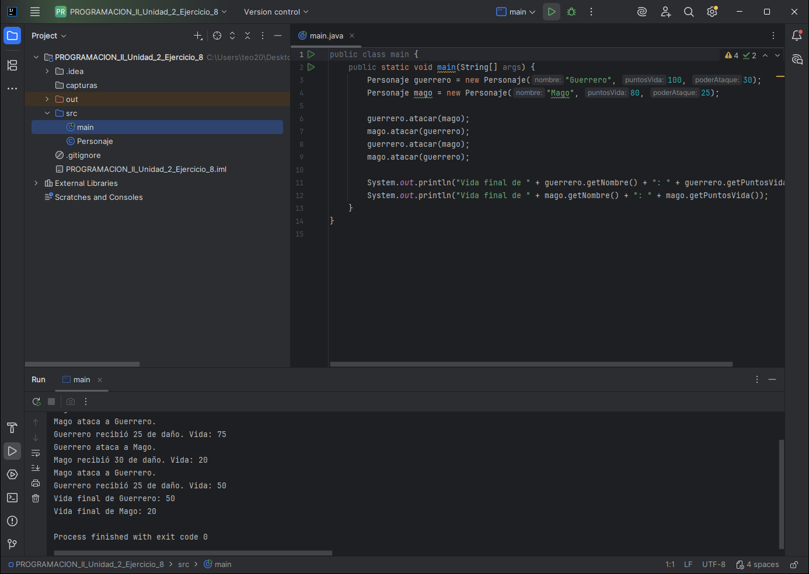

# PROGRAMACIÓN II — Unidad 2, Ejercicio 8: Simulación de Batalla en Videojuego (Ataque y Daño)

Trabajo práctico de Programación II. Este repositorio contiene la resolución en Java del ejercicio 8 de la Unidad 2.

## Consigna

#### Contexto

En un videojuego de rol (RPG), los personajes interactúan constantemente enviándose mensajes de ataque. Un objeto Personaje emite un mensaje de ataque hacia otro personaje, pasándole la potencia del golpe, lo que provoca que el receptor recalcule su nivel de salud.

#### Consigna

Implementar la comunicación orientada a objetos donde una instancia ataca a otra mediante la invocación de un método que modifica el estado interno del objeto receptor.

#### Desarrollo requerido

- Definir la clase Personaje con atributos como nombre, puntosVida (salud) y poderAtaque.
- Implementar el método atacar(Personaje oponente) dentro de la clase Personaje, donde el emisor calcula el daño e invoca un método en el receptor, por ejemplo, oponente.recibirDanio(int cantidad).
- Agregar validaciones para que un personaje con salud en cero (derrotado) no pueda atacar ni recibir más ataques.
- En el método main, crear dos personajes con diferentes atributos y simular una ronda de ataques por turnos, mostrando el resultado de cada interacción en la consola.

## Estructura del repositorio

```
PROGRAMACION_II_Unidad_2_Ejercicio_8/
├── README.md
├── capturas/
│   └── consola.png
└── src/
    ├── main.java   # clase con el método main
    └── Personaje.java
```

## Funcionamiento y lógica

El ejercicio simula un combate por turnos en el que dos objetos de la misma clase interactúan entre sí.

### `Personaje`

Tiene `nombre`, `puntosVida` y `poderAtaque` (privados).

- **`atacar(Personaje oponente)`:** el ataque solo ocurre si el atacante sigue con vida y el oponente todavía no fue derrotado. En ese caso anuncia el ataque y le envía al oponente el mensaje `recibirDanio()` con su poder de ataque.
- **`recibirDanio(int cantidad)`:** resta el daño a los puntos de vida sin bajar de 0 y muestra la vida restante. Si la vida llega a 0, informa que el personaje fue derrotado.
- **Getters:** devuelven el nombre y los puntos de vida.

### `main`

Crea un **Guerrero** (100 de vida, 30 de ataque) y un **Mago** (80 de vida, 25 de ataque), que se atacan por turnos dos veces cada uno:

- El mago recibe 30 + 30 = 60 de daño → queda con **20**.
- El guerrero recibe 25 + 25 = 50 de daño → queda con **50**.

Al final se muestra la vida de cada uno.

## Ejecución

Captura de la consola de IntelliJ IDEA ejecutando el programa:



Salida obtenida:

```
Guerrero ataca a Mago.
Mago recibió 30 de daño. Vida: 50
Mago ataca a Guerrero.
Guerrero recibió 25 de daño. Vida: 75
Guerrero ataca a Mago.
Mago recibió 30 de daño. Vida: 20
Mago ataca a Guerrero.
Guerrero recibió 25 de daño. Vida: 50
Vida final de Guerrero: 50
Vida final de Mago: 20
```
